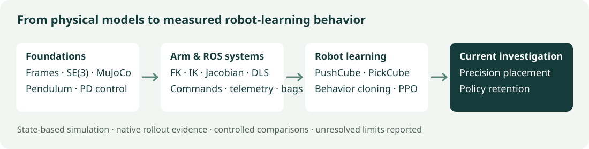

# Physical AI Foundations

[](https://github.com/kudratsingh/physical-ai-foundations/actions/workflows/tests.yml)
[](https://github.com/kudratsingh/physical-ai-foundations/actions/workflows/pages.yml)

Reproducible robotics labs and measured manipulation-learning experiments:
**MuJoCo, ROS 2, ManiSkill, behavior cloning, and PPO policy retention**.
The project connects physical models and feedback control to learning systems
that must place an object and remain successful through a complete rollout.

**[Explore the public reports →](https://kudratsingh.github.io/physical-ai-foundations/)** ·
[Current state](docs/CURRENT_STATE.md) · [Experiment ledger](docs/EXPERIMENTS.md) ·
[Reproduce the latest study](https://github.com/kudratsingh/physical-ai-foundations/blob/4d2dbdaa09e48a74a05857e38212fdc0685360d9/learning/maniskill/STRENGTH_README.md)



## Current state

Documentation refreshed **October 29, 2026**; latest measurements **October 23**.
**Main includes the foundations, arm lab, ROS integration, and learning experiments**
through the fixed-strength study in [PR #19](https://github.com/kudratsingh/physical-ai-foundations/pull/19).
The original experiment commits and evidence snapshots remain available for provenance.

The public hub serves 12 unchanged visual reports from the pinned research
snapshot [`4d2dbda`](https://github.com/kudratsingh/physical-ai-foundations/tree/4d2dbdaa09e48a74a05857e38212fdc0685360d9).
It includes native simulator videos, failure trajectories, protocols and evidence.
See [integration status and scope](docs/CURRENT_STATE.md) for the distinction
between implemented artifacts, verified results and unverified competency gates.

## Latest finding: stronger anchoring is a tradeoff

BC-initialized PPO can improve autonomous PickCube manipulation, but continued
optimization can destroy placement and holding behavior. A frozen-teacher action
loss substantially reduced that regression. The latest experiment tested whether
increasing its coefficient from **λ10 to λ25** preserves more of the gains.

| Training seed | λ10 final successes | λ25 final successes | Change |
|---|---:|---:|---:|
| 42 | 40/50 | 36/50 | −4 |
| 1042 | 40/50 | 37/50 | −3 |
| 2042, predeclared target | 32/50 | 37/50 | +5 |

The unchanged BC teacher scored **31/50 on these fresh test resets**. Each learner
received 262,144 transitions, with the original task, controller, reward and
50-step horizon fixed. **λ25 failed the predeclared criterion:** it helped the
targeted seed but sacrificed too much performance in the other two. Keep λ10 as
the reference. A placement-aware constraint is the proposed next experiment;
it has not been implemented or evaluated.

These are three seed-level comparisons on a shared list of 50 resets, not 150
independent trials or a general reliability claim. Primary fixed-budget finals
are separate from validation-selected checkpoints. The previous teacher-retention
study used different test resets and a teacher score of 26/50; those percentages
must not be compared as a change in the teacher.

[Latest visual report](https://kudratsingh.github.io/physical-ai-foundations/reports/retention-strength/) ·
[Full results and limits](https://github.com/kudratsingh/physical-ai-foundations/blob/4d2dbdaa09e48a74a05857e38212fdc0685360d9/learning/maniskill/STRENGTH_RESULTS.md) ·
[Predeclared protocol](https://github.com/kudratsingh/physical-ai-foundations/blob/4d2dbdaa09e48a74a05857e38212fdc0685360d9/learning/maniskill/STRENGTH_PROTOCOL.md)

## Explore the project

| Track | Implemented artifacts | Where to start |
|---|---|---|
| Physical foundations | Configuration space, frames/SO(3)/SE(3), transforms, pendulum simulation, PD gains and kick recovery | [MuJoCo walkthrough](mujoco/README.md), [frame notes](notes/frames_se3.md) — on main |
| Arm control | Two-link FK/IK, Jacobian, damped least squares, workspace/singularity explorer, torque-limited MuJoCo physics | [Arm lab](https://github.com/kudratsingh/physical-ai-foundations/blob/4d2dbdaa09e48a74a05857e38212fdc0685360d9/notes/planar_arm.md) — on main |
| ROS systems | Jazzy pub/sub, reset service, exact bag replay; separate MuJoCo arm simulator/controller and browser dashboard | [ROS basics](https://github.com/kudratsingh/physical-ai-foundations/blob/4d2dbdaa09e48a74a05857e38212fdc0685360d9/ros2_ws/README.md), [arm systems lab](https://github.com/kudratsingh/physical-ai-foundations/blob/4d2dbdaa09e48a74a05857e38212fdc0685360d9/ros2_ws/ARM_README.md) — on main |
| Robot learning | PushCube/PickCube PPO and BC, observation/optimization diagnostics, critic stability, teacher anchoring and strength ablations | [Visual report hub](https://kudratsingh.github.io/physical-ai-foundations/), [experiment ledger](docs/EXPERIMENTS.md) — on main |
| Learning theory | MDPs, PPO/GAE and executable advantage examples | [Separate PR #13 worksheet](https://github.com/kudratsingh/physical-ai-foundations/blob/52701c2b1f5108060810e9c6f6b41311b88343b7/notes/robot_learning_mdp.md) — on main; sourced from a separate historical branch |

The ROS Week-1 exercise streams synthetic hinge data. The separate ROS arm lab
bridges actual MuJoCo state and commands. ROS is outside the ManiSkill training
loop. All current learned policies use state observations; rendered video is
inspection evidence, not vision-policy input.

## Run the foundations on main

```bash
python3 -m venv .venv
.venv/bin/pip install -r requirements.txt -r requirements-dev.txt
.venv/bin/python mujoco/simulate.py              # three logged rollouts
.venv/bin/python mujoco/pd_control.py            # gains, plots and metrics
.venv/bin/mjpython mujoco/simulate.py --viewer   # macOS interactive viewer
.venv/bin/python -m pytest                      # main's math/MuJoCo contracts
```

For the complete labs and reproducible historical experiments, see the [setup guide](docs/CURRENT_STATE.md#inspect-or-reproduce-the-research-snapshot).
ManiSkill has a **separate Python 3.11 environment**. ROS Jazzy runs in
**Ubuntu 24.04 through Docker**, using its own Python. Keep their dependencies
separate from the foundations environment.

## Related project: SO-101 VLA and RL

A separate, private SO-101 project applies these foundations to simulated
demonstrations, vision-language-action fine-tuning, RL and planned real-robot
evaluation. Its current results and task definitions are separate from the
Panda PickCube studies. [Explore the SO-101 project](https://kudratsingh.github.io/physical-ai-foundations/so101.html).

## What verification means

PR #19 passed four CI checks: core tests, ManiSkill, ROS 2, and ROS arm. Its local
validation recorded **314 core tests and 186 learning/evidence tests**, including
independent reconstruction of physical outcomes, selection and paired reset IDs.
Those counts describe that research snapshot; the main badge above covers the
smaller suite actually on main. CI checks contracts and smoke runs, not an
independent repeat of all six full training experiments.

The latest report includes 650 episode outcomes, 32,500 passive state/action
records, all 59 successful-then-displaced final trajectories, and 14 native
videos. Full policy checkpoints and demonstration datasets remain ignored local
artifacts; their availability is a reproduction requirement, not a download
provided by this repository.

Reliable retention across seeds, long-budget stability, different teachers,
vision, hardware and sim-to-real transfer remain open. Written notes and built
artifacts do not independently certify oral competency gates.

[Publishing and maintenance](docs/PUBLISHING.md) ·
[Public report checksums](https://kudratsingh.github.io/physical-ai-foundations/provenance.json)
